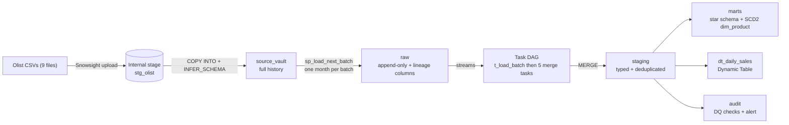

# Olist ELT Pipeline on Snowflake

An incremental ELT pipeline built entirely inside Snowflake on a free trial account. It loads the Brazilian Olist e-commerce dataset (9 tables, about 1.55 million rows), replays it as monthly batches, captures changes with streams, merges them with a task DAG, and serves a star schema with an SCD Type 2 product dimension, automated data quality checks, an alert, and a Dynamic Tables comparison.

No external infrastructure is used. Everything runs from Snowsight worksheets.

## Architecture

## Data

Source: [Brazilian E-Commerce Public Dataset by Olist](https://www.kaggle.com/datasets/olistbr/brazilian-ecommerce) (Kaggle). Orders from 2016 to 2018, with items, payments, reviews, customers, sellers, products, geolocation and a category translation table.

## Layers

| Schema | Purpose |
|---|---|
| `raw` | Every column stored as text, plus `_source_file` and `_loaded_at` lineage columns. Append-only. A bad value can never break a load, and every row traces back to its file. |
| `source_vault` | Full copy of the transactional tables, used to replay data as if it arrived in batches. |
| `staging` | Typed, trimmed, deduplicated data. Zip codes padded to 5 digits. Duplicate review IDs removed. Geolocation reduced to one row per zip prefix. |
| `marts` | Star schema: `fact_order_items`, `fact_payments`, `dim_date`, `dim_customer`, `dim_seller`, `dim_product` (SCD2). Also the Dynamic Table `dt_daily_sales`. |
| `audit` | Batch control, data quality results, alert log, the batch loader and the DQ procedure. |

## Key design decisions

- **Text-only raw layer.** Types are applied in staging with `TRY_` casts. A check counts values that silently became NULL, so no data is lost without being noticed.
- **Batch replay.** `sp_load_next_batch` loads one purchase month at a time into `raw`, which simulates incremental arrival. A batch control table tracks which months are done.
- **Change capture with streams.** Append-only streams on each raw table record only the rows added since the last merge.
- **Idempotent merges.** Five child tasks run in parallel after the root task. Each one deduplicates the stream and uses `MERGE`, so re-running a batch cannot create duplicates. Each child skips itself when its stream is empty (`SYSTEM$STREAM_HAS_DATA`).
- **SCD Type 2 product dimension.** Changed products close their old row (`valid_to`, `is_current = FALSE`) and open a new one. Facts join to the product version that was valid at purchase time, so history is preserved.
- **Data quality.** Ten checks write results to `audit.dq_results`: key uniqueness, referential integrity, value ranges, and reconciliation of fact row counts and revenue against staging. One check is a warning (orders with no items). An alert logs a message when any error-level check fails.
- **Dynamic Tables comparison.** The same kind of aggregate is built declaratively with a Dynamic Table, to compare effort and refresh cost against streams and tasks.

## Results

Fill in the values below from your own runs.

| Metric | Value |
|---|---|
| Raw rows loaded | TODO |
| Monthly batches replayed | TODO |
| Staging row counts match the source (all tables) | TODO |
| DQ checks (errors / warnings) | TODO |
| Warehouse | X-Small, auto-suspend 60 seconds |
| Credits used for the whole project | TODO (from the Snowsight trial balance) |
| Dynamic Table refresh: rows changed vs total rows | TODO |

## Streams and tasks vs Dynamic Tables

| | Streams + tasks | Dynamic Table |
|---|---|---|
| Code | Roughly 100 lines of `MERGE` statements | One `SELECT` |
| Control | Full: custom logic, audit columns, ordering | Declarative: Snowflake decides how to refresh |
| Scheduling | You define the DAG and the schedule | You define a freshness target (`TARGET_LAG`) |
| Limits | None beyond SQL | Some SQL is not supported incrementally |
| Observed refresh | TODO | TODO: `INCREMENTAL` with N rows changed |

## How to run

Run the scripts in order from a Snowsight worksheet. Each one is safe to read before running, and the comments explain the step.

| Script | What it does |
|---|---|
| `sql/00_setup.sql` | Resource monitor, warehouse, database, schemas, file format, stage |
| `sql/01_raw_load.sql` | Creates the raw tables from the CSV headers and loads them |
| `sql/02_staging.sql` | Typed, deduplicated staging tables |
| `sql/03a_batch_simulation.sql` | Moves history to `source_vault`, creates the batch loader and the streams |
| `sql/03b_tasks.sql` | Root task and five parallel merge tasks |
| `sql/04a_catchup.sql` | Loads all remaining batches and runs the DAG |
| `sql/04b_marts.sql` | Dimensions, SCD2 procedure, facts |
| `sql/04c_scd2_demo.sql` | Changes a product and shows the history |
| `sql/05_dq_alerts.sql` | DQ procedure, results view, alert, failure demo |
| `sql/06_dynamic_table.sql` | Dynamic Table and the incremental refresh demo |

Before running, upload the 9 Olist CSVs to `@olist_dw.raw.stg_olist` through Snowsight (Ingestion, Add Data, Load files into a stage).

## Screenshots

TODO: add images under `docs/img/` and link them here.

- Task graph with all tasks succeeded
- DQ results table
- SCD2 history for one product
- Dynamic Table refresh history

## Limitations and next steps

- Built on a Snowflake free trial: external network access, Openflow and hybrid tables are unavailable, and Cortex AI usage is capped.
- Batches are replayed from a vault table. In production the raw layer would be fed by Snowpipe from cloud storage.
- The fact tables are rebuilt in full. At this size that is cheap, but a production version would load them incrementally.
- Possible extensions: put the mart build and the DQ run into the task DAG, add column-level masking policies, add a Streamlit dashboard.
